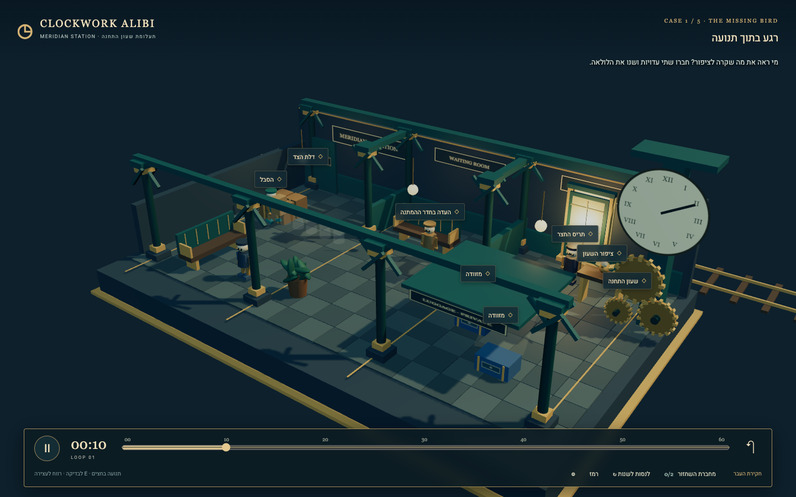
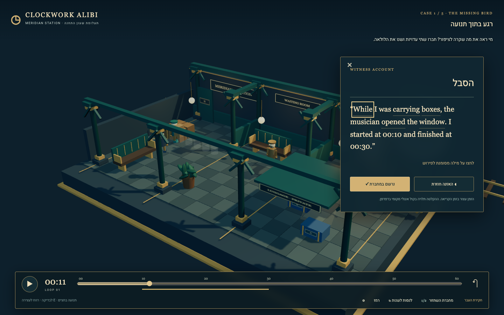

# Visual comparison

Reviewed by the independent art/asset helper on 26 October 2026. This review compares actual files by opening and inspecting their pixels. It does not infer successful visuals from source code alone.

## Evidence opened

- Generated design target: `docs/visual-targets/target-01.png` (16:9; built-in imagegen; not implemented-game evidence).
- Actual browser gameplay: `docs/evidence/gameplay-investigation.png` (1440 × 900, case 1 at 00:10).
- Actual browser witness interaction: `docs/evidence/gameplay-witness.png` (1440 × 900, case 1 at 00:11, reading panel open and time paused).

## What the actual captures establish

The implemented station is a real elevated three-quarter 3D cutaway with visible depth, floor tiles, short room divisions, pillars, benches, a lit window, luggage, a clock dial and gears. The teal, dark stone, brass and ivory palette matches the target's principal colors. The right-edge clock and central porter preserve the target's recognizable composition. Shadows, tilted props, perspective and overlapping surfaces establish three-dimensional space.

The gameplay occupies the main viewport with a narrow bottom time control. The witness view retains the scene and uses one readable English account with Hebrew controls. In this desktop capture the LTR English line wrapping is legible, and the reading state shows the paused play control. The title/case hierarchy is restrained and the investigation scene avoids a dashboard of cards.

These two still frames do not establish movement quality, touch usability, the complete time-loop interaction, animated rig deformation, complete occlusion across every time, or success/failure behavior. Those require separate gameplay evidence.

## Gaps against the target

| Aspect | Target | Actual capture and implication |
|---|---|---|
| Scene occupancy | Environment nearly fills the image, with close foreground depth and little empty background | Actual scene has a broad dark top margin and visible diorama edges. It reads as a clean miniature toy rather than the target's immersive station. The floor reaches the bottom, but the upper empty space reduces environmental presence. |
| Materials and detail | Rich stone reflections, rivets, worn brass, curved ironwork and detailed furniture | Actual uses simple flat materials and geometric silhouettes. Colors are cohesive, but surfaces look sparse and uniform. This is a substantial fidelity gap, not a matching finished render. |
| Light | Strong warm side-window light travels across the floor, with local practical lamps | Actual window is bright, while most of the station remains evenly cool. Some shadows are clear, but the amber glow and material highlights are much weaker than the target. |
| Characters and bird | Detailed brass porter, recognizable bird, full-body animated character | Actual shows small procedural automata and a small geometric bird. No acquired Tripo GLB or verified rig is present; this remains an unmet asset requirement. |
| Clock silhouette | Tall layered clockwork structure at right | Actual preserves a large clock with three gears. It is recognizable, but gear structure is much simpler and the clock face is visually oversized relative to character detail. |
| Labels | One contextual witness caption and mostly unobstructed scene | Investigation capture displays many floating labels simultaneously. They help discoverability but compete with world detail and make the room read as a collection of hotspots. Limiting distant labels to nearby, selected or temporarily requested targets would improve exploration and clarity. |
| Witness UI | Small lower caption near the speaker | Actual uses a right-side notebook occupying roughly one seventh of the frame. It is larger than the target, but deliberately supports readable English, vocabulary interaction, replay audio and Hebrew help while paused. It obscures the clock/window region while open. |
| Timeline | Slim toolbar with two overlapping action tracks | Actual has a clear scrubber, time and play/pause control. The investigation/witness frames do not show the target's two overlapping colored action tracks. This comparison does not claim those visual tracks have been implemented. |
| Occlusion | Partial offscreen views preserve the need for witness accounts | A luggage canopy is visible in the actual investigation frame. Its coverage cannot be fully proven by this still image. The player should not receive the suitcase identity or complete gust destination through an unrestricted replay view. |

## Corrections and their verification status

The reviewed full-viewport investigation and witness captures were taken after the closer camera position (13.8, 12.8, 18) and amber window point light were applied. Those adjustments are visible in the reviewed evidence, and the remaining occupancy and lighting gaps above refer to that improved state. Only the permanent lower/wider opaque luggage canopy and transfer lantern/cart positions moved to the left with a ladder were later source edits. Source inspection confirms those later changes exist, but fresh captures are needed to verify their visible effect. Earlier uncommitted canvas captures in work/web-game-stable used the pre-zoom camera and were not the comparison evidence for this review.

Correction priority:

1. Preserve English necessity: verify the opaque luggage coverage at every relevant time and viewpoint; verify that a full visual replay does not identify the correct container without the offscreen accounts.
2. Build on the already captured closer camera and amber window light: reduce the remaining top void and strengthen warm floor illumination while keeping all physical intervention areas reachable and visible. Preserve the right-edge clock and three-room depth; capture any further adjustments for comparison.
3. Reduce simultaneous floating labels. Show local/selected targets prominently; keep a discoverability control for distant targets if needed.
4. Complete real Tripo model acquisition and porter rig/animation when browser control is available. Procedural stand-ins should remain clearly disclosed meanwhile.
5. Add material variation and richer mechanical silhouettes after gameplay and frame budget are secure. Keep the coherent palette rather than adding decorative UI.

## Deliberate differences

- The actual slice uses a simpler stylized miniature style to keep the authored station legible. It does not reach the target's detailed material quality.
- Hebrew menus and help, explicit English text direction, on-demand vocabulary and paused reading require a larger account panel than the generated target's one-line caption.
- The visible private luggage canopy is a learning constraint: it protects information that players must obtain through English witness accounts.
- The actual capture uses a 16:10 desktop viewport, while the generated target is 16:9. Matching screen percentage exactly would require same-size recaptures.

## External and measurement limitations

Tripo acquisition remains blocked by browser-control timeouts; `ASSETS.md` and `docs/asset-browser-blocker.md` record the attempts. No Tripo model, rig or animation has been acquired or visually verified. Do not label the current procedural automata as rigged Tripo characters.

GPU performance has not been measured on a representative student device or a normal hardware-accelerated browser. The lead observed around 1 FPS in a software-rendered headless run under shared-host load. That observation is a real limitation of the tested environment and does not support a playable-performance claim or a representative GPU benchmark. A hardware browser run and mobile device check remain necessary.

No claim of student learning gain, fun validation with students, or final visual parity follows from these captures.
