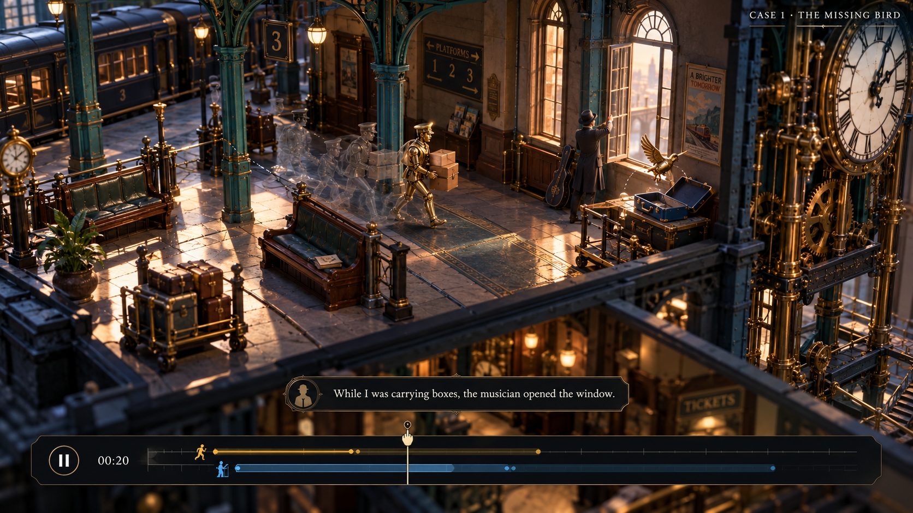
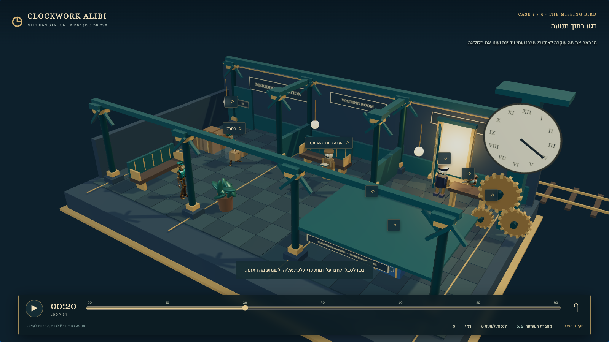

# Visual comparison

Refreshed by the art/asset helper on 26 October 2026 after opening the actual images listed below beside the saved built-in imagegen target. The final implementation preserves the target's miniature station, palette, elevated camera and time-tool hierarchy. Final browser QA passed all five cases in the built static preview with the actual integrated models, touch controls, persistence and recoverable mistakes. It remains a simpler stylized diorama with substantially less architectural/material detail than the generated target. Required Tripo bird and rigged character assets are now acquired and integrated; the earlier acquisition blocker is resolved.

## Evidence and versions

| Image / record inspected | Version and use |
|---|---|
| `docs/visual-targets/target-01.png` | Generated 16:9 design target; built-in imagegen; not implemented-game evidence |
| `docs/evidence/integrated/01-final-target-state.png` | Final 1600 × 900 case 1 at 00:20; real three-clip porter, independently cloned player, bird and hand-socket crates |
| `docs/evidence/integrated/04-original-history.png` | Final case 1 at 00:22; original-history trial, learned interval and explicit trial status |
| `docs/evidence/integrated/06-mobile-account.png` | Final 390 × 844 case 2 English witness account and paused reading controls |
| `docs/evidence/integrated/07-mobile-quote-recap.png` | Final portrait reconstruction recap; one recorded viewpoint and visible clock-test action |
| `docs/evidence/integrated/09-overlap-contradiction.png` | Final case 2 contradiction, quoted English evidence and two visible activity tracks |
| `docs/evidence/integrated/12-transfer-account.png` | Final changed left-side layout, ladder and original English lantern/side-door/CANVAS account |
| `docs/evidence/integrated/13-transfer-win.png` | Final changed transfer recovered, with physical action and joined-evidence results |
| `docs/evidence/integrated/14-bird-restored.png` | Final return to case 1 after finishing; bird, porter, player and props remain mounted |
| `docs/evidence/integrated/report.json` and paired state JSONs | Clean complete five-case, touch, real-model, mistake/retry and persistence QA; empty app/HTTP error lists and no diagnostic keyboard recoveries |
| `docs/asset-local-model-check.png`, `docs/asset-local-carry-check.png` | Actual isolated local-GLB renders used to verify bird identity and inspect the custom clip; asset checks rather than gameplay screenshots |
| `docs/evidence/performance-metal.json`, `docs/evidence/performance-software.json` | Separate hardware-Metal and software-fallback performance observations |

All eight selected final PNGs above were opened and visually inspected for this refresh. The rebuilt-preview mobile account and recap were then reopened after the portrait control fix; their bytes match the final committed-path captures. Earlier `work/reviewer-world-smoke` captures show the resumed walk-only version before the final carry/idle export and hand props; they remain historical investigation evidence and are superseded here by the committed final integrated captures.

## Direct target comparison

| Aspect | Generated target | Current actual capture and assessment |
|---|---|---|
| Composition and depth | Close elevated three-quarter station interior with foreground rails, deep rooms and almost no blank backdrop | Actual uses the same camera family and a real cutaway station, with perspective, layered beams, pillars, floor tiles, short room divisions, benches and a large right-edge clock. The wide diorama and dark top margin leave more empty space than the target. The model's footprint fills most of the width, but it is less immersive. |
| Color and light | Teal iron, midnight stone, ivory dials and copper, with strong amber side-window light and reflective floor streaks | Principal colors match. The latest image has controlled darker stone, clear shadows and a warm window. It avoids the chalky over-bright interim environment. Amber floor illumination and metallic variation are still weaker than the target; much of the architecture remains evenly lit. |
| Architecture and materials | Dense wrought iron, curved brackets, rivets, layered gears, worn surfaces and detailed furniture | Actual architecture is deliberately geometric and flat compared with the target. Strong teal/brass silhouettes and tiles establish the station, but furniture, stone and gear detail remain much simpler. This is a substantial fidelity gap, not final visual parity. |
| Porter and player | Detailed brass porter carrying a chest-height stack in clear view | Actual now uses the acquired brass/teal clock-faced porter and a separately cloned skinned player. At this wide view the porter is small, and a foreground beam/label obscures part of its upper body at 00:20. Its distinctive material is clearer in close asset evidence than in this composition. |
| Carried props | Two boxes stacked against the chest | The custom Tripo motion did not retain the requested bent-elbow support pose. Actual presentation was adapted to two lower handled crates attached to real left/right hand sockets. The crates follow the rig's real bone movement and remain upright. This is an intentional physical-contact correction, not a claim that AI animation exactly matched the prompt. |
| Bird and clock | Small recognizable mechanical bird beside the opened window; ornate clock mechanism | Actual bird is a real copper/teal sparrow GLB, verified directly from its local file. It appears tiny on the right shelf at the station camera. The large dial and three simplified gears preserve the target's clock silhouette, with much less layered machinery. |
| Hotspots and HUD | Sparse scene, one local witness caption and a slim bottom timeline | Actual keeps a sparse title/case header and a bottom timeline about one eighth of viewport height. Distant physical targets now use compact markers; witness/nearby labels retain words. This is clearer than the earlier all-label view, though marker density and a few beam overlaps still compete with small characters. |
| Time information | Two simultaneous activity tracks in a reveal state | The default 00:20 actual has no acquired facts and therefore does not reveal answer tracks. The final original-history trial shows a learned carrying interval and moving time cursor. The final case 2 contradiction shows both overlapping activity tracks and the English account used to explain the error. |
| Witness and result panels | Small lower one-line English caption | Actual uses one larger opaque notebook/result panel. The final transfer win keeps the world visible and clearly separates physical action from joining witness accounts. The final portrait account/recap remain readable. A follow-up hides the movement pad while reading panels are open; refreshed built-preview captures visibly confirm the lower-left controls are clear. The larger reading format supports LTR English, vocabulary, replay audio and Hebrew help while time is paused. It covers more of the scene than the target. |
| Offscreen evidence | Partial visibility, with a reveal of the gust in the target frame | The opaque private-luggage canopy is now a prominent actual 3D obstruction. It deliberately hides the destination/identity that English accounts supply. A static image cannot prove every viewpoint/time is protected; this remains part of gameplay QA. The actual 00:20 frame need not show a gust that the authoritative simulation schedules later. |

## Corrections visibly established

The latest actual frame establishes the final local Tripo character/bird integration, the darker material/light pass, compact distant markers, the lower/wider opaque luggage canopy and the final handled crate presentation. The prior broad claims that Tripo assets were missing are obsolete. `ASSETS.md` records final files, 65-joint Mixamo skin, all three exported clips, hashes, sizes, displayed credits and provenance.

The final original-history, contradiction, transfer and return-to-bird captures now show those states with the final models. The independent integrated report records actual carry/walk/idle selection and changing bone poses, deterministic scrub, independent player skeleton, a wrong timestamp that remains wrong and consumes an attempt, a notebook-free world route, touch latch/recovery, same-color identity mistakes, useful questions/key recovery, alternate securing and the changed no-solution-hint transfer. Finite completion and Play Again preserve mounted models and prior assistance history. Its final navigation log contains no diagnostic keyboard recoveries, and app/audio/HTTP checks were clean. All 48 automated rule/navigation checks passed; detailed commands and scope are in `PLAYTEST.md`.

These are completed functional browser checks, not inference from still images. The stills separately verify visible presentation. No student enjoyment or learning claim follows from an automated success chain.
Remaining visual correction priorities are clearer witness silhouettes around foreground beams, larger readable object detail when inspecting the bird, stronger localized amber light and richer architectural/material variation. These should preserve the offscreen evidence constraint and measured frame budget. They are polish gaps rather than missing required external assets.

## Deliberate differences and portrait tradeoffs

- The final scene is a simpler stylized miniature. It does not reproduce the target's high-detail realistic surfaces or dense machinery.
- Lower side-carried handled crates suit the actual generated full-body motion. The chest-stack pose in the target was not reproduced.
- The default investigation view withholds answer information; learned tracks and evidence appear only after investigation. The target depicts a later reveal state.
- An opaque private-luggage canopy protects facts that must be learned through English, even though it takes more visual space than the target's partial walls.
- Hebrew controls, explicit English direction, vocabulary help and replayable audio require a larger paused reading panel. The final portrait capture shows readable account wrapping and visible controls, while covering most of the 3D scene during reading. An earlier capture showed the movement pad overlapping the lower-left reading controls. The final follow-up hides it while a panel is open; both refreshed mobile account and recap pixels were opened and confirm the overlap is resolved. Portrait play therefore prioritizes local exploration and reading over seeing the complete station at once. Responsive browser QA passed touch controls and navigation at 390 × 844. Physical-device touch comfort and low-end-device character/scene legibility remain untested.
- The refreshed desktop actual is 1600 × 900, matching the target's 16:9 aspect ratio. The earlier 1440 × 900 captures used 16:10 and are historical.

## Performance and validation limits

`docs/evidence/performance-metal.json` records an 8.008-second 1600 × 900 run using `ANGLE Metal Renderer: Apple M2 Max`: 483 rendered frames, **60.32 measured FPS** (the in-game sampling hook reported 56). This establishes smooth rendering in that measured hardware-backed desktop environment for that bounded run. It is not a student-device or long-session benchmark.

The separate `docs/evidence/performance-software.json` uses SwiftShader software Vulkan: four frames over 8.019 seconds, **0.50 FPS**. That fallback performs poorly and must not be averaged with, or presented as, the hardware-Metal result. Hardware acceleration matters for this tested build.

Browser automation and static captures do not establish student learning gains, engagement/fun with students, universal mobile performance or final pixel-level parity with the generated target. The remaining simplified architecture, small wide-view character/bird detail, imperfect AI carrying gesture and portrait scene visibility are disclosed. No runtime Tripo connection or runtime AI is required.
